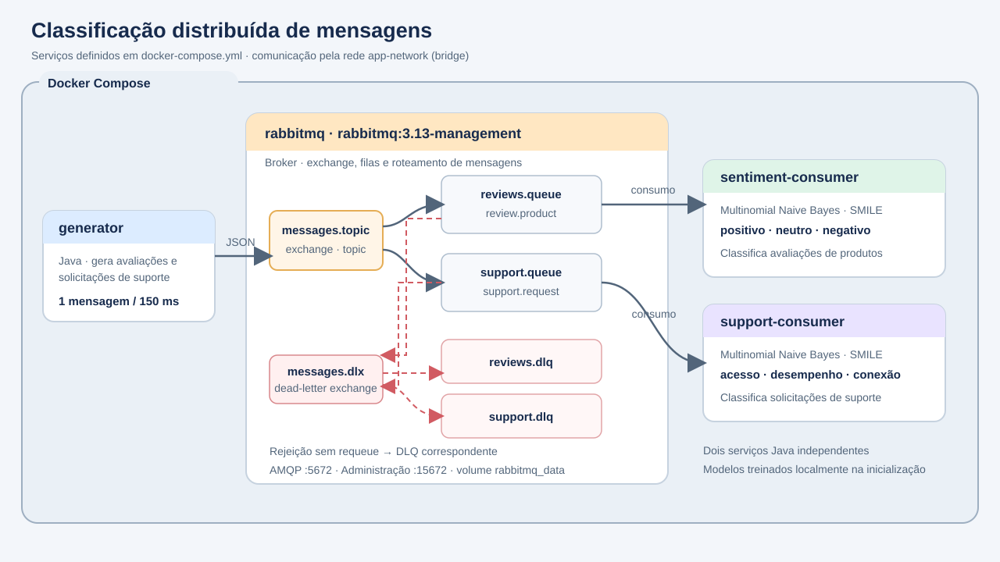

# Classificação distribuída de mensagens com RabbitMQ

MVP da Atividade 5: um gerador publica mensagens em um broker RabbitMQ, que as distribui para dois consumidores Java independentes. Cada consumidor classifica um tipo de mensagem usando um modelo local.

## Arquitetura



O `docker-compose.yml` inicia quatro serviços na rede Docker `app-network`:

1. **rabbitmq** — broker RabbitMQ 3.13 com exchange `messages.topic`, filas e dead-letter queues (DLQs). O volume `rabbitmq_data` persiste os dados do broker; as portas `5672` e `15672` ficam disponíveis para AMQP e para a interface de administração.
2. **generator** — aplicação Java que produz mensagens de avaliação (`review.product`) e solicitações de suporte (`support.request`) e as publica no exchange.
3. **sentiment-consumer** — consome `reviews.queue` e classifica o sentimento das avaliações.
4. **support-consumer** — consome `support.queue` e classifica o assunto das solicitações de suporte.

O exchange do tipo `topic` roteia cada chave para a fila correspondente. Mensagens malformadas ou com `[FORCE_ERROR]` são rejeitadas sem requeue e encaminhadas pelo exchange `messages.dlx` às filas `reviews.dlq` ou `support.dlq`. Os consumidores usam ACK manual e prefetch de uma mensagem.

O gerador publica uma mensagem a cada 150 ms. Cada consumidor aguarda 1,2 s após classificar uma mensagem, por padrão; por isso, as filas principais podem crescer durante a demonstração.

## IAs e classificação

O projeto não chama APIs de IA nem serviços externos. Os dois consumidores usam classificadores locais **Multinomial Naive Bayes**, disponibilizados pela biblioteca Java **SMILE**. Na inicialização, cada modelo é treinado com exemplos de texto rotulados embutidos no próprio código. O texto é normalizado, tokenizado e convertido em frequências de palavras para a classificação.

- **Sentimento (`sentiment-consumer`)** — atribui às avaliações uma das classes `positivo`, `neutro` ou `negativo`.
- **Categoria de suporte (`support-consumer`)** — classifica solicitações como `acesso`, `desempenho` ou `conexão`.

Esses modelos demonstrativos são pequenos e treinados apenas com os exemplos do projeto; não são modelos generativos nem serviços remotos.

## Requisitos

- Docker com Docker Compose v2.
- Para executar os testes Maven localmente: JDK 21 e Maven 3.9 ou superior.

## Instruções de execução

Na raiz do projeto, inicie os serviços:

```powershell
docker compose up --build
```

O gerador e os consumidores mostram as mensagens e classificações nos logs. Para acompanhar os logs em outro terminal:

```powershell
docker compose logs -f
```

A interface de administração do RabbitMQ fica em <http://localhost:15672> (usuário `app`, senha `app` por padrão). Nela, é possível observar `reviews.queue`, `support.queue` e as DLQs `reviews.dlq` e `support.dlq`.

Para simular falhas e demonstrar o roteamento para as DLQs, configure `SIMULATE_FAILURE_EVERY` antes de iniciar o Compose. O exemplo abaixo adiciona uma falha a cada dez mensagens:

```powershell
$env:SIMULATE_FAILURE_EVERY = "10"
docker compose up --build
```

Também é possível ajustar a espera de processamento dos consumidores, que por padrão é de 1200 ms:

```powershell
$env:PROCESSING_DELAY_MS = "300"
docker compose up --build
```

Para personalizar as credenciais do broker, defina `RABBITMQ_USER` e `RABBITMQ_PASSWORD` antes de iniciar os serviços. Os valores padrão são `app` e `app`.

Para encerrar os serviços:

```powershell
docker compose down
```

Para remover também o volume persistente do RabbitMQ e zerar as filas:

```powershell
docker compose down --volumes
```

### Compilar e testar sem Docker

```powershell
mvn test
```

## Estrutura do projeto

```text
common/              Contrato da mensagem, topologia RabbitMQ e classificador compartilhado
generator/           Gerador e publicador de mensagens
sentiment-consumer/  Consumidor e modelo local de sentimento
support-consumer/    Consumidor e modelo local de suporte
Dockerfile           Build Java reutilizado pelos três serviços
docker-compose.yml   Broker e três aplicações na rede Docker
docs/arquitetura.svg Diagrama dos serviços e dos fluxos de mensagens
```
